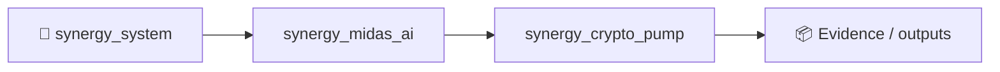

# CRYPTO PUMP V2 — Unified Early-Pump ML Research Stack

`crypto_pump` is a research monorepo for **forward prediction and cross-sectional ranking of abnormal upside in low-cap cryptocurrencies and memecoins**.

The repository pins 15 public research/codebases as Git submodules and distills their strongest reproducible ideas into one native V2 pipeline.

> Research only. Pump-and-dump markets are adversarial and manipulated. A prediction metric or backtest is not evidence of executable profit. Point-in-time universe construction, delistings, fees, spread, slippage, market impact and latency must be included before any trading conclusion.

## The V2 question

V2 deliberately does **not** optimize "is this candle already pumping?". It estimates four future events from information available at or before `t`:

```text
P(+10% within 15m | X<=t)
P(+20% within 1h  | X<=t)
P(+50% within 6h  | X<=t)
P(+100% within 24h| X<=t)
```

Defaults assume 5-minute bars. Each target is built from future highs versus the current close and stores MFE, MAE, end-of-horizon return and first target-hit bar. Rows without the complete future horizon are censored rather than mislabeled as negatives.

## Distilled architecture

```text
CEX OHLCV / order flow ───────┐
DEX / launch / wallet data ───┤
Social / news aggregates ─────┼──> causal V2 feature store
BTC / market benchmark ───────┘                │
                                               ├─> multi-horizon CatBoost
                                               ├─> CatBoost YetiRank / NDCG
past-only symbol sequences ────────────────────┼─> causal Temporal Transformer
wallet ↔ token edges (timestamp <= as_of) ─────┼─> Wallet/Transaction GNN
social-only feature family ────────────────────┼─> social branch
BTC-relative residual ─────────────────────────┴─> BOCD regime score
                                                         │
                                                         v
                                             validation-only stacker
                                                         │
                                             isotonic calibration
                                                         │
                                                         v
                                              4 pump probabilities
                                                         │
                                                         v
                                             per-timestamp Top-K rank
```

The final score is not a hand-weighted average. Branch outputs are fitted by a validation-only logistic stacker; with enough support the result is isotonic-calibrated.

## Validation

Several useful upstream repositories use random train/test splits or shuffled StratifiedKFold. Those procedures are unsafe for a time-evolving trading problem. V2 uses expanding **purged walk-forward OOS**:

```text
TRAIN | longest-target purge | VALIDATION | purge + embargo | TEST
```

For the default 24-hour target on 5-minute bars, the purge is `288` bars. Every test probability is generated by a model trained and calibrated on earlier timestamps only.

## Feature families

V2 clean-room distills:

- **microstructure:** quote-volume z-score, volume/trade acceleration, buy pressure, flow/depth/slippage imbalance, long-trade share, RSI, volatility and cross-sectional ranks;
- **pre-breakout:** activity acceleration versus bounded current price displacement, compression and distance-to-range features;
- **launch/on-chain:** `tx_per_sec`, time-decayed activity, liquidity growth, creator history and virtual liquidity;
- **wallet quality:** Gini/top-wallet concentration, repeat/dust/unknown/low-history/sniper rates, smart-wallet score and bot-pressure composites;
- **social:** mentions, unique users, sentiment, velocity, acceleration, z-scores, cross-platform breadth and coordination;
- **regime:** asset-vs-BTC residual plus bounded Bayesian Online Changepoint Detection.

See [`docs/UPSTREAM_AUDIT_V2.md`](docs/UPSTREAM_AUDIT_V2.md) for the 15-source audit and exactly what was accepted/rejected.

## Install

```bash
git clone --recurse-submodules https://github.com/Shtenco/crypto_pump.git
cd crypto_pump
python -m venv .venv
source .venv/bin/activate   # Windows: .venv\Scripts\activate
pip install -e .
```

For CatBoost/XGBoost/LightGBM: `pip install -e '.[boosting]'`.
For the causal Transformer + wallet GNN: `pip install -e '.[deep,boosting]'`.

Alternative research sandbox:

```bash
python scripts/bootstrap_upstreams.py
python scripts/verify_v2_sources.py
```

## Input schemas

Minimum market panel:

```text
timestamp,symbol,open,high,low,close,volume
```

Useful optional columns include:

```text
quote_volume,trades,buy_volume,sell_volume,bid_depth,ask_depth,
taker_buy_quote,buy_trade_count,quote_slippage_signed,quote_slippage_abs,
unique_buyers,unique_sellers,holders,liquidity,activity_duration_sec,age_seconds,
current_vsol,initial_vsol,creator_success,creator_num_tokens,
wallet_gini,top_buyer_pct,top3_buyer_pct,top5_share,
repeat_buyer_rate,dust_buy_rate,unknown_buyer_pct,low_history_pct,
sniper_pct,avg_top_buyer_smart,social_mentions,social_users,sentiment,
coordination_score,cross_platform_breadth,new_account_rate
```

Optional GNN edge table requires `timestamp,wallet,symbol` and may add `amount,direction,wallet_smart_score`.

## Run V2

```bash
crypto-pump features-v2 data/raw/market.parquet data/processed/features_v2.parquet
crypto-pump labels-v2 data/processed/features_v2.parquet data/processed/labeled_v2.parquet

crypto-pump walk-forward-v2 \
  data/processed/labeled_v2.parquet \
  artifacts/v2_oos \
  --model-kind auto
```

Full deep stack:

```bash
crypto-pump walk-forward-v2 \
  data/processed/labeled_v2.parquet \
  artifacts/v2_oos_deep \
  --transactions data/processed/wallet_edges.parquet \
  --enable-temporal \
  --enable-gnn
```

After OOS research, fit a final model and score the latest universe:

```bash
crypto-pump train-v2 data/processed/labeled_v2.parquet artifacts/crypto_pump_v2.joblib
crypto-pump rank-v2 data/processed/features_v2.parquet artifacts/crypto_pump_v2.joblib artifacts/latest_v2_ranking.parquet
```

## OOS artifacts and metrics

Every walk-forward run writes `fold_N_model.joblib`, `oos_predictions.parquet` and `oos_metrics.json`. The OOS file retains branch-level probabilities so Transformer, GNN, social and BOCD contributions can be ablated independently.

Metrics are reported per horizon: `PR-AUC`, `ROC-AUC`, `Brier`, `Log loss`, `Precision@K`, `NDCG@K`.

## 15 pinned upstream repositories

1. `B0R0koko/pump-and-dump-prediction`
2. `Bayi-Hu/Pump-and-Dump-Detection-on-Cryptocurrency`
3. `cakcora/Chainoba`
4. `baseershah7/Solana_Memecoin_Graduation`
5. `gayatri1505/Solana-Memcoin-Prediction-Using-Machine-Learning`
6. `Based-LTD/graduate-oracle`
7. `Wendy1890/crypto_pump_predictor_bot`
8. `Derposoft/crypto_pump_and_dump_with_deep_learning`
9. `uasth/CryptoAnomalyDetection`
10. `lidialosavio-dotcom/crypto_fraud_stGNN`
11. `Confringo233/PumpWatcher`
12. `mfzhang/20260115-Pump_and_Dump_detect_signal`
13. `Mehrnoom/Cryptocurrency-Pump-Dump`
14. `lodetomasi/the-intelligent-llm-investor`
15. `RaibekTussupbekov/binance-pump-dump-detector`

They remain pinned at specific commits under `upstreams/`; native clean-room V2 code is under `src/crypto_pump/v2/`.

Architecture details: [`docs/V2_ARCHITECTURE.md`](docs/V2_ARCHITECTURE.md).

## Current status

**V2 implements the multi-branch training architecture and leakage controls.** The next empirical stage is collecting a point-in-time dataset large enough to train all branches, then running the frozen V2 protocol across exchanges/launchpads and measuring whether each branch contributes incremental OOS Top-K value after realistic costs.


<!-- SYNERGY-FEDERATION-PASSPORT:START -->
---

## 🧭 SYNERGY federation passport

**Домен:** 📈 Crypto ML research  
**Архитектурный родитель:** [`synergy_midas_ai`](https://github.com/Shtenco/synergy_midas_ai)  
**Архитектурный корень:** [`synergy_system`](https://github.com/Shtenco/synergy_system)



### Документационный контракт

README должен показывать: проблему → архитектуру → реальные артефакты → проверку → ограничения → связи с федерацией. Сильные claims без evidence остаются R&D/CANDIDATE.

### Навигация

- [📚 Атлас всех 75 репозиториев](https://github.com/Shtenco/synergy_system/blob/main/docs/SYNERGY_REPOSITORY_ATLAS.md)
- [🧾 Машиночитаемый registry](https://github.com/Shtenco/synergy_system/blob/main/registry/SYNERGY_REPOSITORIES.json)
- [🧭 SYNERGY SYSTEM](https://github.com/Shtenco/synergy_system)

### Authority rule

Репозиторий не присваивает полномочия соседнего домена: AI ≠ authorization, UI ≠ ledger, blockchain commitment ≠ accounting truth, backtest ≠ realized external P&L.

<!-- SYNERGY-FEDERATION-PASSPORT:END -->